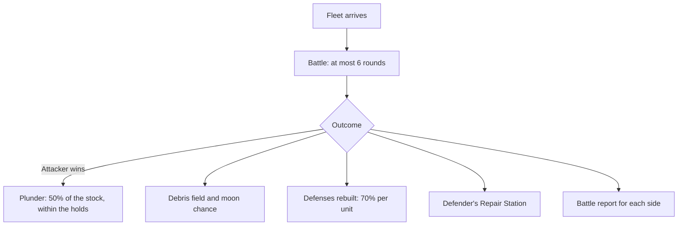

# Combat

**How battles work and what follows.**

A fleet on an Attack mission fights whatever defends the target planet or moon: ships in orbit and defenses. The battle lasts at most 6 rounds, then come the loot, the debris, the moon chance and the repairs.

## Pages in this section

- [How combat works](/en/combat/how-combat-works): stats, rounds, rapid fire, shields, explosions.
- [Reading a battle report](/en/combat/battle-report): what each side sees, partial view, sharing.
- [Plunder](/en/combat/plunder): the share taken and the cargo space.
- [Debris fields](/en/combat/debris): debris, recycling and moon formation.
- [Defense rebuild](/en/combat/defense-rebuild): the 70% roll per destroyed defense.
- [Battle simulator](/en/combat/simulator): preparing an attack.
- [Moon destruction](/en/combat/moon-destruction): Stellar Colossi and the two rolls.
