# The Archivist

> **In short**: "Nothing is lost". The Archivist recovers what others leave behind: knowledge someone already found (Memory), battle wreckage (Wreck), and its own fleet when it falls (Registry).
{.is-info}

> Ship names are provisional English translations: the game still shows French names (see the [glossary](/en/getting-started/glossary)).
{.is-warning}

## Rules

1. The Archivist is a class **exclusive to [The Heritage](/en/dynasty/dynasties)**: only players of that dynasty can take it.
2. Its tree has **three branches**: Memory, Wreck and Registry.
3. Each branch has 9 rows and costs 15 points. With 25 points at most, you complete one branch and its ultimate, plus a second branch down to row 6 (10 points). How points, gates and choices work is described on [Talents](/en/dynasty/talents).
4. **Known level**: a research level already held, at that level or higher, by **25%** of the universe's counted players. Counted players are those active in the last 7 days, not in vacation mode and not bots. The count is redone once a day. The whole Memory branch only affects these levels.
5. The speed of a known level (Known Levels, Archive Holdings) and that of Lessons of Defeat **add** to your research speed, outside its caps. Speed, cost and known status are set when the study **starts**.
6. **Debris harvests**: the bonus applies to the metal and crystal your Salvagers actually load, so within their hold. It is paid on return, takes no hold space and takes nothing more from the field.
7. **Loss registry**: the registry, shared by your whole empire, lists the ships lost in combat, those of a fleet as well as those defending a planet. Defences never enter it. An order placed from the registry, on any planet, gets the registry's terms within the quantities it holds, drawing first on the oldest losses.
8. The registry's speed **adds** to the ships' build speed: a duration is divided by (1 + sum of bonuses). The registry's cost reduction applies **on the price already reduced** by your other ship reductions.
9. The class's only **accent** is the speed of recycling missions (Wreck Race), within the talents' fleet speed budget. The dock, combat recycling and debris hydrogen belong to the Admiral; defences to the Veteran.

## Worked example

**Memory**: Weapon Systems 10 (409,600 metal, 102,400 crystal), universe research speed ×1, Innovation Center 10: **46 h 32 min 44 s** with no talent. The level is known.
- Known Levels (+10%): **42 h 18 min 51 s**.
- With Archive Holdings at rank 3 (+25% in total): **37 h 14 min 12 s**. With Catching Up, 5 or more levels behind (+40%): **33 h 14 min 49 s**.
- Rediscovery at rank 3 (−12%): **360,448** metal and **90,112** crystal.
- Momentum: Weapon Systems 11, if known, takes 93 h 05 min 27 s, brought down to 74 h 28 min 22 s by the +25%. It starts with 10% of that time done, **7 h 26 min 50 s**; with Headway at rank 3 (25%), **18 h 37 min 05 s**.
- The same Weapon Systems 10, started within 24 h of a defeat with Lessons of Defeat: 25 + 20 = 45% → **32 h 06 min 02 s**.

**Wreck**: 100 Corvettes destroyed, universe with 30% debris (Redline): 600,000 metal and 210,000 crystal, that is 810,000 resources. It takes 41 Salvagers (20,000 hold each, without Hyperspace Technology).
- Scrapper and Metal Sorting at rank 3 (+25%): +150,000 metal and +52,500 crystal, **1,012,500** brought back. The field loses 810,000, no more.
- Arriving less than 1 h after the battle, with Fresh Wrecks (+45%): **1,174,500**.
- With only 30 Salvagers (600,000 hold): 444,444 metal and 155,555 crystal loaded pro rata, the bonus applies to them; 210,001 resources stay in the field.

**Registry**: 200 Corvettes lost, that is 4,000,000 metal, 1,400,000 crystal and 400,000 hydrogen (5,800,000 resources).
- Indemnity: 5% of their price, that is **290,000** resources paid at once (200,000 / 70,000 / 20,000); **464,000** with War Chest at rank 3 (8%).
- Kept Blueprints at rank 3 (−12%): 4,000,000 → **3,520,000** metal; with War Discount (−20% in total), **3,200,000**.
- A rebuild taking 10 h with no talent: **8 h 41 min 45 s** with Loss Registry (+15%), **7 h 41 min 33 s** with Relief Lines at rank 3 (+30%), **6 h 40 min** with Back to the Front (+50%). With Swift Relief on top, within 24 h of the loss (+70%): **5 h 52 min 57 s**.

## Detailed data

### Tree at a glance

The three branches of the class tree, from row 1 to the ultimate. Each talent is detailed in the tables.

```mermaid
graph TB
    subgraph B3[" "]
        B3H["REGISTRY<br/>Getting up faster than you fall."]:::head
        B3R1{{"Loss Registry<br/>1 pt"}}:::key
        B3H --- B3R1
        B3R2("Kept Blueprints<br/>3 pts"):::rank
        B3R1 --- B3R2
        B3R3A["① Swift Relief<br/>1 pt"]:::option
        B3R3B["② Long Memory<br/>1 pt"]:::option
        B3R2 --- B3R3A
        B3R2 --- B3R3B
        B3G3(["🔒 5 points in the tree"]):::gate
        B3R3A --- B3G3
        B3R3B --- B3G3
        B3R4("Relief Lines<br/>3 pts"):::rank
        B3G3 --- B3R4
        B3R5{{"Indemnity<br/>1 pt"}}:::key
        B3R4 --- B3R5
        B3R6A["① Back to the Front<br/>1 pt"]:::option
        B3R6B["② War Discount<br/>1 pt"]:::option
        B3R5 --- B3R6A
        B3R5 --- B3R6B
        B3G6(["🔒 12 points in the tree"]):::gate
        B3R6A --- B3G6
        B3R6B --- B3G6
        B3R7("War Chest<br/>3 pts"):::rank
        B3G6 --- B3R7
        B3R8{{"Lessons of Defeat<br/>1 pt"}}:::key
        B3R7 --- B3R8
        B3R9[["✦ Relief Yard<br/>ultimate"]]:::ultimate
        B3R8 --- B3R9
    end
    subgraph B2[" "]
        B2H["WRECK<br/>First to reach what drifts."]:::head
        B2R1{{"Scrapper<br/>1 pt"}}:::key
        B2H --- B2R1
        B2R2("Wreck Radar<br/>3 pts"):::rank
        B2R1 --- B2R2
        B2R3A["① Scavenger<br/>1 pt"]:::option
        B2R3B["② Wreck Race<br/>1 pt"]:::option
        B2R2 --- B2R3A
        B2R2 --- B2R3B
        B2G3(["🔒 5 points in the tree"]):::gate
        B2R3A --- B2G3
        B2R3B --- B2G3
        B2R4("Metal Sorting<br/>3 pts"):::rank
        B2G3 --- B2R4
        B2R5{{"Wreck Alert<br/>1 pt"}}:::key
        B2R4 --- B2R5
        B2R6A["① Salvage Garrison<br/>1 pt"]:::option
        B2R6B["② Fresh Wrecks<br/>1 pt"]:::option
        B2R5 --- B2R6A
        B2R5 --- B2R6B
        B2G6(["🔒 12 points in the tree"]):::gate
        B2R6A --- B2G6
        B2R6B --- B2G6
        B2R7("On-Call Crew<br/>3 pts"):::rank
        B2G6 --- B2R7
        B2R8{{"Sweep-All<br/>1 pt"}}:::key
        B2R7 --- B2R8
        B2R9[["✦ Seals<br/>ultimate"]]:::ultimate
        B2R8 --- B2R9
    end
    subgraph B1[" "]
        B1H["MEMORY<br/>What others have already found."]:::head
        B1R1{{"Known Levels<br/>1 pt"}}:::key
        B1H --- B1R1
        B1R2("Rediscovery<br/>3 pts"):::rank
        B1R1 --- B1R2
        B1R3A["① Alliance Library<br/>1 pt"]:::option
        B1R3B["② Public Library<br/>1 pt"]:::option
        B1R2 --- B1R3A
        B1R2 --- B1R3B
        B1G3(["🔒 5 points in the tree"]):::gate
        B1R3A --- B1G3
        B1R3B --- B1G3
        B1R4("Archive Holdings<br/>3 pts"):::rank
        B1G3 --- B1R4
        B1R5{{"Momentum<br/>1 pt"}}:::key
        B1R4 --- B1R5
        B1R6A["① Catching Up<br/>1 pt"]:::option
        B1R6B["② Neck and Neck<br/>1 pt"]:::option
        B1R5 --- B1R6A
        B1R5 --- B1R6B
        B1G6(["🔒 12 points in the tree"]):::gate
        B1R6A --- B1G6
        B1R6B --- B1G6
        B1R7("Headway<br/>3 pts"):::rank
        B1G6 --- B1R7
        B1R8{{"Working Memory<br/>1 pt"}}:::key
        B1R7 --- B1R8
        B1R9[["✦ Universal Library<br/>ultimate"]]:::ultimate
        B1R8 --- B1R9
    end
    classDef head fill:#111b2e,stroke:#2a3852,color:#e6ecf7,stroke-width:1px;
    classDef key fill:#1c1606,stroke:#f5c542,color:#fde9a8,stroke-width:2px;
    classDef rank fill:#0e1a30,stroke:#4f8cff,color:#e6ecf7,stroke-width:2px;
    classDef option fill:#101827,stroke:#46546e,color:#cfd8e6,stroke-width:1px;
    classDef gate fill:#241b06,stroke:#c99a2e,color:#f5c542,stroke-width:1px;
    classDef ultimate fill:#1a1630,stroke:#e2c068,color:#fff6d8,stroke-width:3px;
    linkStyle default stroke:#33415c,stroke-width:2px,fill:none;
    style B1 fill:#0b1322,stroke:#1e2a40,stroke-width:1px;
    style B2 fill:#0b1322,stroke:#1e2a40,stroke-width:1px;
    style B3 fill:#0b1322,stroke:#1e2a40,stroke-width:1px;
```

### Memory

*What others have already found.*

| Row | Node | Type | Effect (full node) | Per rank |
|---|---|---|---|---|
| 1 | **Known Levels** | key | A research level already held by 25% of the universe's active players is known: you study it 10% faster, and the innovation center flags it. |  |
| 2 | **Rediscovery** | 3 ranks | Your known levels cost 12% less. | 3 × 4% |
| 3 | **A · Alliance Library** | choice | A level a member of your alliance holds counts as known. | |
|  | **B · Public Library** |  | A level is known as soon as 10% of the active players hold it. | |
| 4 | **Archive Holdings** | 3 ranks | Your known levels are studied 15% faster still. | 3 × 5% |
| 5 | **Momentum** | key | When you complete a known level, the next level of the same research, if known, starts with 10% of its time already done. |  |
| 6 | **A · Catching Up** | choice | On a research where you are 5 levels or more behind the most common level, Archive Holdings counts twice. | |
|  | **B · Neck and Neck** |  | Any level the player ranked just above you holds counts as known. | |
| 7 | **Headway** | 3 ranks | Momentum gives the next level 15% more head start. | 3 × 5% |
| 8 | **Working Memory** | key | A known level starts without the innovation center level it requires: the other requirements are enough. |  |
| 9 | **Universal Library** | ultimate | A level counts as known as soon as a single player of the universe holds it. Only the first to reach it gains nothing on that research. |  |

- **Alliance Library**: a level another member of your alliance holds, at that level or higher. **Neck and Neck**: the player ranked just above you in the general ranking. Both lists are read again once a day.
- **Momentum**: the completed level must be known, and the next one known when you start it. The head start is a share of the study's real duration and adds past the Theorist's head start ceiling. One momentum at a time: completing another known level replaces it.
- **Catching Up**: the most common level is the one the most counted players hold exactly (the lowest on a tie). Only the Archive Holdings share counts double: 10 + 15 × 2 = 40%.
- **Working Memory** only waives the required Innovation Center level: the planet must still have an Innovation Center.
- **Universal Library**: a single counted player is enough. A level held only by bots or by inactive or vacationing players does not become known this way.

### Wreck

*First to reach what drifts.*

| Row | Node | Type | Effect (full node) | Per rank |
|---|---|---|---|---|
| 1 | **Scrapper** | key | Your debris harvests yield 10% more. The bonus is paid on the way home, takes no hold space and empties the field no further. |  |
| 2 | **Wreck Radar** | 3 ranks | Debris fields show on your map up to 15 systems around your planets, even on positions never explored. | 3 × 5 |
| 3 | **A · Scavenger** | choice | You recycle a field without having scouted its position: you leave as soon as you see it. | |
|  | **B · Wreck Race** |  | Your recycling missions fly 10% faster. | |
| 4 | **Metal Sorting** | 3 ranks | Your debris harvests yield 15% more still. | 3 × 5% |
| 5 | **Wreck Alert** | key | You are warned as soon as a field of more than 50,000 resources appears within your radar's range: the race starts before the others. |  |
| 6 | **A · Salvage Garrison** | choice | When one of your planets is attacked, its docked recyclers harvest the field as soon as the battle ends, before the attacker's. | |
|  | **B · Fresh Wrecks** |  | On a field that appeared less than 1 h ago, your harvests yield 20% more. | |
| 7 | **On-Call Crew** | 3 ranks | When the alert rings, your recyclers leave on their own from the nearest planet, even while you sleep, up to 3 times a day. | 3 × 1 |
| 8 | **Sweep-All** | key | In the same flight, your recyclers also harvest the fields of the neighbouring positions (±1 in the same system), as far as their holds allow. |  |
| 9 | **Seals** | ultimate | Once a day, you seal a field you can see: for 1 h, other players no longer see it nor send recyclers to it. Those already flying arrive as usual. |  |

- **Wreck Radar**: up to 15 systems around each of your planets, in the same galaxy.
- **Scavenger**: you may recycle any cell without having scouted it, whether the radar shows it or not.
- **Wreck Alert** rings every time a field in your radar receives debris and exceeds 50,000 resources, even if it already did. Not for a field another player has sealed.
- **Salvage Garrison**: after an attack on your planet, its Salvagers still docked harvest the whole field above it, old debris included, before the attacker's. Metal and crystal go straight to the stock, with the Scrapper and Metal Sorting bonus.
- **Fresh Wrecks** is measured from the last debris added to the field to the **arrival** of your Salvagers. It adds to the 25% of Scrapper and Metal Sorting, past their cap.
- **On-Call Crew**: the Salvagers leave from your nearest planet that has some, within radar range, as many as the field needs, at full speed. No departure if one of your fleets already targets that cell. The 24 h count opens at the first departure. A departure refused by the flight rules (hydrogen, fleet slots, cell never scouted without Scavenger) costs nothing.
- **Sweep-All** sweeps the neighbouring fields after the targeted one, in the hold space left, except a field sealed by another player.
- **Seals**: a non-empty field you see, a cell scouted by you or your alliance, or covered by your radar. The 24 h are counted from the last seal. Impossible on a field already sealed by another player.

### Registry

*Getting up faster than you fall.*

| Row | Node | Type | Effect (full node) | Per rank |
|---|---|---|---|---|
| 1 | **Loss Registry** | key | The registry keeps the ships you lose in combat for 7 days: they are rebuilt 15% faster, up to the quantities lost. |  |
| 2 | **Kept Blueprints** | 3 ranks | Registry ships cost 12% less. | 3 × 4% |
| 3 | **A · Swift Relief** | choice | For 24 h after a loss, the registry rebuilds 20% faster still. | |
|  | **B · Long Memory** |  | The registry keeps your losses for 21 days, for those who rebuild over time. | |
| 4 | **Relief Lines** | 3 ranks | Registry ships are rebuilt 15% faster still. | 3 × 5% |
| 5 | **Indemnity** | key | After a battle in which you lose ships, 5% of their value is paid at once to the planet they left from. |  |
| 6 | **A · Back to the Front** | choice | Registry ships are rebuilt 20% faster still. | |
|  | **B · War Discount** |  | Registry ships cost 8% less still. | |
| 7 | **War Chest** | 3 ranks | Indemnity pays you 3% more of the value lost. | 3 × 1 pts |
| 8 | **Lessons of Defeat** | key | After a battle in which you lose more than you destroy, your Weapon Systems, Shielding Technology and Armor Technology research runs 20% faster for 24 h. |  |
| 9 | **Relief Yard** | ultimate | The registry rebuilds on a second shipyard line, alongside your normal one: no more choosing between rearming and building on. |  |

- **Swift Relief** counts 24 h from **the last** loss still in the registry.
- **Indemnity** is computed on the normal price of the ships lost, resource by resource, and goes to the planet the fleet left from, or to the defended planet, if it is still yours.
- **Lessons of Defeat**: a defeat is a planet attack, attacking or defending, where you lost more unit points (ships and defences) than the opponent. Only studies started during those 24 h go faster: a study already running does not change. Each new defeat restarts the 24 h.
- **Relief Yard**: registry orders get their own queue, alongside the normal ship queue.

### Class caps

The most the talents of both trees can bring this class, lever by lever. Past it, a point adds nothing. The dynasty trait then adds on top.

| Class cap (talents of both trees) | What the class tree reaches |
|---|---|
| +25% research speed on known levels | 25% |
| −12% research cost on known levels | 12% |
| A level is known as soon as 10% of the universe's players hold it | 10% |
| +25% resources yielded by a debris harvest | 25% |
| +10% fleet speed on recycling missions | 10% |

Two bonuses go past these caps: Catching Up takes a known level's speed to 40%, and Fresh Wrecks adds 20 points to harvests on a fresh field (45%).

### 25-point builds

| Build | Split | What it gets |
|---|---|---|
| The catcher-up | Memory 15 · Registry 10 | Universal Library, Working Memory; known levels +25% (+40% with Catching Up) and −12%, 25% head start on each chained level; registry +50% with Back to the Front (otherwise +30% and −20% with War Discount), Kept Blueprints −12%, Indemnity 5% |
| The scavenger | Wreck 15 · Memory 10 | Seals, Wreck Alert, On-Call Crew, Sweep-All; harvests +25%; known levels +25% and −12%, Momentum 10% |
| The unbreakable | Registry 15 · Wreck 10 | Relief Yard, Indemnity 8%, Lessons of Defeat, registry up to +70%; harvests +25%, radar at 15 systems, Salvage Garrison or Fresh Wrecks |

Before row 7 of the main branch, place at least 2 points in the second one: the gate requires 12 points, and rows 1 to 6 of a branch only hold 10.

## Common pitfalls

- **A known level is judged on counted players** (active within 7 days, not on vacation, not bots), and the count is only redone once a day.
- **The first on a research gets nothing from Memory** on that research: nobody is ahead of them.
- **Everything is set at start**: a level becoming known during the study does not speed it up, and Lessons of Defeat does not speed up a study already running.
- **Public Library becomes useless with Universal Library**, which already asks for less: a single holder.
- **The harvest bonus follows the hold**: it applies to what your Salvagers load, not to the whole field. It does not drain the field further: other players can still harvest what is left.
- **On-Call Crew without Scavenger** fails on a cell never scouted.
- **Fresh Wrecks is judged on arrival**, not on departure: count the flight time.
- **The registry only covers ships lost in combat**, within the quantities lost and for 7 days (21 with Long Memory). Defences do not enter it.
- **Swift Relief only lasts 24 h** after the last loss.

## Related pages

- [Dynasties](/en/dynasty/dynasties)
- [Classes](/en/dynasty/classes)
- [Talents](/en/dynasty/talents)
- [Common tree](/en/dynasty/common-tree)
- [Debris fields](/en/combat/debris)
- [Technology list](/en/research/technologies)
