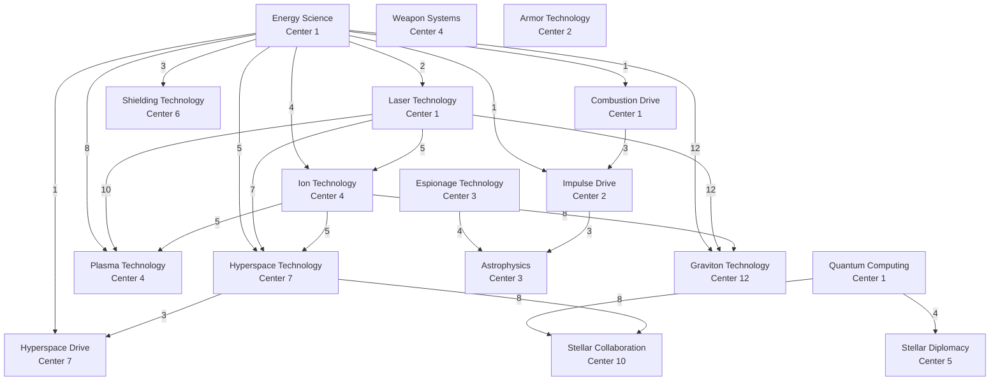

# Tech tree

> **In short**: most buildings, technologies, ships and defenses require certain levels elsewhere first. For each item, this page lists everything you need to reach, then what each building and technology unlocks. Every value comes from the game catalogue.
{.is-info}

> Ship names are provisional English translations: the game still shows French names (see the [glossary](/en/getting-started/glossary)).
{.is-warning}

## Rules

1. A requirement is a **minimum level** of a building or a technology.
2. Until a requirement is met, the item stays locked in the game.
3. A **building** requirement is read on the planet (or moon) where you build or start the research. A **technology** requirement applies to the whole empire. In the full paths, the Innovation Center is that of the planet starting each research: for the Jump gate, built on a moon, it stands on one of your planets.
4. Requirements chain: a required technology has its own requirements. The path tables give the **full list**, chains included, keeping the highest level asked for each item.
5. A **building**'s requirements are only checked for its first level on a planet. A **technology**'s are checked at every level, on the planet starting it; a **ship**'s or a **defense**'s, at every order.
6. Lunar buildings (Sensor phalanx, Jump gate) need a Lunar base on the same moon.
7. **Queueing**: a requirement already counts if an order placed earlier will reach it (a building on the same planet, a study anywhere in the empire). It is checked again when the order starts; if it is missing then, the order is dropped at no cost.

## Worked example

To build your first **Space Pioneer** and colonize, you need in total:
- Buildings, on the planet building it: Innovation Center 3, Automaton Factory 2, Orbital Dock 4.
- Technologies: Energy Science 1, Combustion Drive 3, Impulse Drive 3, Espionage Technology 4, Astrophysics 1.

The Stellar Colossus, the most demanding ship, has 9 requirements in all, including the Innovation Center and the Orbital Dock at level 12, their maximum.

## Detailed data

### Requirements between technologies

Each arrow shows the level required; under each name, the Innovation Center level required.

### Full paths: ships

| Goal | Everything you need to reach |
|---|---|
| Cargo Shuttle | Innovation Center 1, Automaton Factory 2, Orbital Dock 2, Energy Science 1, Combustion Drive 2 |
| Stellar Freighter | Innovation Center 1, Automaton Factory 2, Orbital Dock 4, Energy Science 1, Combustion Drive 6 |
| Space Pioneer | Innovation Center 3, Automaton Factory 2, Orbital Dock 4, Energy Science 1, Combustion Drive 3, Impulse Drive 3, Espionage Technology 4, Astrophysics 1 |
| Salvager | Innovation Center 6, Automaton Factory 2, Orbital Dock 4, Energy Science 3, Combustion Drive 6, Shielding Technology 2 |
| Scout | Innovation Center 3, Automaton Factory 2, Orbital Dock 3, Energy Science 1, Combustion Drive 3, Espionage Technology 2 |
| Solar Collector | Automaton Factory 2, Orbital Dock 1 |
| Interceptor | Automaton Factory 2, Orbital Dock 1 |
| Assailant | Innovation Center 2, Automaton Factory 2, Orbital Dock 3, Armor Technology 2 |
| Corvette | Innovation Center 4, Automaton Factory 2, Orbital Dock 5, Energy Science 4, Combustion Drive 3, Impulse Drive 4, Laser Technology 5, Ion Technology 2 |
| Battleship | Innovation Center 7, Automaton Factory 2, Orbital Dock 7, Energy Science 5, Hyperspace Drive 4, Laser Technology 7, Ion Technology 5, Hyperspace Technology 3 |
| Orbital Striker | Innovation Center 4, Automaton Factory 2, Orbital Dock 8, Energy Science 8, Plasma Technology 5, Combustion Drive 3, Impulse Drive 6, Laser Technology 10, Ion Technology 5 |
| Predator | Innovation Center 7, Automaton Factory 2, Orbital Dock 8, Energy Science 5, Hyperspace Drive 5, Laser Technology 12, Ion Technology 5, Hyperspace Technology 3 |
| Annihilator | Innovation Center 7, Automaton Factory 2, Orbital Dock 9, Energy Science 5, Hyperspace Drive 6, Laser Technology 7, Ion Technology 5, Hyperspace Technology 3, Armor Technology 6 |
| Stellar Colossus | Innovation Center 12, Automaton Factory 2, Orbital Dock 12, Energy Science 12, Hyperspace Drive 7, Laser Technology 12, Ion Technology 8, Hyperspace Technology 6, Graviton Technology 1 |

### Full paths: defenses and missiles

| Goal | Everything you need to reach |
|---|---|
| Ballistic Projector | Automaton Factory 2, Orbital Dock 1 |
| Photonic Cannon | Innovation Center 1, Automaton Factory 2, Orbital Dock 2, Energy Science 2, Laser Technology 3 |
| High-Energy Emitter | Innovation Center 1, Automaton Factory 2, Orbital Dock 4, Energy Science 3, Laser Technology 6 |
| Magnetic Accelerator | Innovation Center 6, Automaton Factory 2, Orbital Dock 6, Energy Science 6, Shielding Technology 1, Weapon Systems 3 |
| Ion Battery | Innovation Center 4, Automaton Factory 2, Orbital Dock 4, Energy Science 4, Laser Technology 5, Ion Technology 4 |
| Plasma Ejector | Innovation Center 4, Automaton Factory 2, Orbital Dock 8, Energy Science 8, Plasma Technology 7, Laser Technology 10, Ion Technology 5 |
| Defensive Barrier | Innovation Center 6, Automaton Factory 2, Orbital Dock 1, Energy Science 3, Shielding Technology 2 |
| Protective Dome | Innovation Center 6, Automaton Factory 2, Orbital Dock 6, Energy Science 3, Shielding Technology 6 |
| Interception Missile | Automaton Factory 2, Orbital Dock 1, Ballistic Arsenal 2 |
| Long-Range Warheads | Innovation Center 2, Automaton Factory 2, Orbital Dock 1, Ballistic Arsenal 4, Energy Science 1, Combustion Drive 3, Impulse Drive 1 |

### Full paths: buildings

Only buildings with requirements are listed.

| Goal | Everything you need to reach |
|---|---|
| Thermonuclear Reactor | Hydrogen Condenser 5, Innovation Center 1, Energy Science 3 |
| Orbital Dock | Automaton Factory 2 |
| Molecular Assembler | Innovation Center 1, Automaton Factory 10, Quantum Computing 10 |
| Planetary Modulator | Innovation Center 1, Automaton Factory 10, Molecular Assembler 1, Energy Science 12, Quantum Computing 10 |
| Repair Station | Automaton Factory 2, Orbital Dock 2 |
| Ballistic Arsenal | Automaton Factory 2, Orbital Dock 1 |
| Logistics Center | Innovation Center 1, Quantum Computing 2 |
| Sensor phalanx | Lunar base 1 |
| Jump gate | Innovation Center 7, Lunar base 1, Energy Science 5, Laser Technology 7, Ion Technology 5, Hyperspace Technology 7 |

### Full paths: technologies

| Goal | Everything you need to reach |
|---|---|
| Energy Science | Innovation Center 1 |
| Laser Technology | Innovation Center 1, Energy Science 2 |
| Ion Technology | Innovation Center 4, Energy Science 4, Laser Technology 5 |
| Hyperspace Technology | Innovation Center 7, Energy Science 5, Laser Technology 7, Ion Technology 5 |
| Plasma Technology | Innovation Center 4, Energy Science 8, Laser Technology 10, Ion Technology 5 |
| Combustion Drive | Innovation Center 1, Energy Science 1 |
| Impulse Drive | Innovation Center 2, Energy Science 1, Combustion Drive 3 |
| Hyperspace Drive | Innovation Center 7, Energy Science 5, Laser Technology 7, Ion Technology 5, Hyperspace Technology 3 |
| Weapon Systems | Innovation Center 4 |
| Shielding Technology | Innovation Center 6, Energy Science 3 |
| Armor Technology | Innovation Center 2 |
| Espionage Technology | Innovation Center 3 |
| Quantum Computing | Innovation Center 1 |
| Astrophysics | Innovation Center 3, Energy Science 1, Combustion Drive 3, Impulse Drive 3, Espionage Technology 4 |
| Stellar Collaboration | Innovation Center 10, Energy Science 5, Quantum Computing 8, Laser Technology 7, Ion Technology 5, Hyperspace Technology 8 |
| Graviton Technology | Innovation Center 12, Energy Science 12, Laser Technology 12, Ion Technology 8 |
| Stellar Diplomacy | Innovation Center 5, Quantum Computing 4 |

### What each building unlocks

| Building | Unlocks (level required) |
|---|---|
| Hydrogen Condenser | Thermonuclear Reactor (5) |
| Innovation Center | Energy Science, Laser Technology, Combustion Drive, Quantum Computing (1); Impulse Drive, Armor Technology (2); Espionage Technology, Astrophysics (3); Ion Technology, Plasma Technology, Weapon Systems (4); Stellar Diplomacy (5); Shielding Technology (6); Hyperspace Technology, Hyperspace Drive (7); Stellar Collaboration (10); Graviton Technology (12) |
| Automaton Factory | Orbital Dock (2); Molecular Assembler (10) |
| Orbital Dock | Ballistic Arsenal, Solar Collector, Interceptor, Ballistic Projector, Defensive Barrier, Interception Missile, Long-Range Warheads (1); Repair Station, Cargo Shuttle, Photonic Cannon (2); Scout, Assailant (3); Stellar Freighter, Space Pioneer, Salvager, High-Energy Emitter, Ion Battery (4); Corvette (5); Magnetic Accelerator, Protective Dome (6); Battleship (7); Orbital Striker, Predator, Plasma Ejector (8); Annihilator (9); Stellar Colossus (12) |
| Molecular Assembler | Planetary Modulator (1) |
| Ballistic Arsenal | Interception Missile (2); Long-Range Warheads (4) |
| Lunar base | Sensor phalanx, Jump gate (1) |

### What each technology unlocks

| Technology | Unlocks (level required) |
|---|---|
| Energy Science | Combustion Drive, Impulse Drive, Hyperspace Drive (1); Laser Technology (2); Thermonuclear Reactor, Shielding Technology, High-Energy Emitter (3); Ion Technology (4); Hyperspace Technology (5); Magnetic Accelerator (6); Plasma Technology (8); Planetary Modulator, Graviton Technology (12) |
| Laser Technology | Photonic Cannon (3); Ion Technology (5); High-Energy Emitter (6); Hyperspace Technology (7); Plasma Technology (10); Graviton Technology, Predator (12) |
| Ion Technology | Corvette (2); Ion Battery (4); Hyperspace Technology, Plasma Technology, Predator (5); Graviton Technology (8) |
| Hyperspace Technology | Hyperspace Drive (3); Stellar Colossus (6); Jump gate (7); Stellar Collaboration (8) |
| Plasma Technology | Orbital Striker (5); Plasma Ejector (7) |
| Combustion Drive | Cargo Shuttle (2); Impulse Drive, Scout (3); Stellar Freighter, Salvager (6) |
| Impulse Drive | Long-Range Warheads (1); Astrophysics, Space Pioneer (3); Corvette (4); Orbital Striker (6) |
| Hyperspace Drive | Battleship (4); Predator (5); Annihilator (6); Stellar Colossus (7) |
| Weapon Systems | Magnetic Accelerator (3) |
| Shielding Technology | Magnetic Accelerator (1); Salvager, Defensive Barrier (2); Protective Dome (6) |
| Armor Technology | Assailant (2); Annihilator (6) |
| Espionage Technology | Scout (2); Astrophysics (4) |
| Quantum Computing | Logistics Center (2); Stellar Diplomacy (4); Stellar Collaboration (8); Molecular Assembler (10) |
| Astrophysics | Space Pioneer (1) |
| Graviton Technology | Stellar Colossus (1) |

Stellar Collaboration and Stellar Diplomacy unlock nothing: their value lies in their effect (see [Technologies list](/en/research/technologies)).

## Common pitfalls

- **Espionage Technology leads to colonization**: its level 4 is needed for Astrophysics, hence for the Space Pioneer.
- **The Innovation Center is the real lock**: Stellar Collaboration, Graviton Technology need a level 10 Center or higher on the planet starting the research. Level 12 is also the Center's maximum.
- **Hyperspace Technology opens heavy propulsion**: without Hyperspace Technology 3, no Hyperspace Drive, hence no Battleship.
- **Quantum Computing leads to alliances**: its level 4 is needed for Stellar Diplomacy, itself needed to found an alliance.
- **The Orbital Dock is built on each planet**: its requirements (Automaton Factory 2) and the Dock levels ships ask for are read on the planet building them.

## Related pages

- [Technologies list](/en/research/technologies)
- [Stellar Collaboration](/en/research/stellar-collaboration)
- [Buildings list](/en/economy/buildings)
- [Ships list](/en/fleet/ships)
- [Defenses list](/en/defense/defenses)
- [Missiles](/en/defense/missiles)
