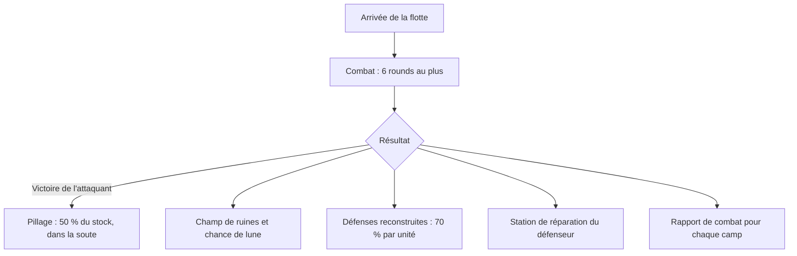

# Combat

**Déroulement des combats et leurs suites.**

Une flotte en mission Attaque combat ce qui défend la planète ou la lune visée : vaisseaux en orbite et défenses. Le combat dure au plus 6 rounds, puis viennent le butin, les débris, la chance de lune et les réparations.

## Pages de cette rubrique

- [Déroulement d'un combat](/fr/combat/how-combat-works) : statistiques, rounds, tirs rapides, boucliers, explosions.
- [Lire un rapport de combat](/fr/combat/battle-report) : ce que chaque camp voit, vue partielle, partage.
- [Pillage](/fr/combat/plunder) : la part emportée et la soute.
- [Champs de ruines (débris)](/fr/combat/debris) : débris, recyclage et formation des lunes.
- [Reconstruction des défenses](/fr/combat/defense-rebuild) : le tirage à 70 % par défense détruite.
- [Simulateur de combat](/fr/combat/simulator) : préparer une attaque.
- [Destruction de lune](/fr/combat/moon-destruction) : les Colossus stellaires et les deux tirages.
