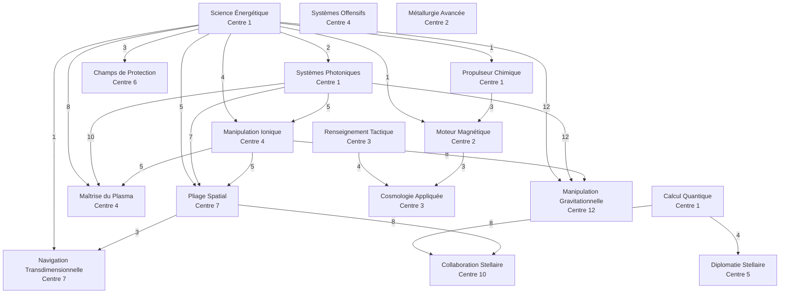

# Arbre technologique

> **En bref** : la plupart des bâtiments, technologies, vaisseaux et défenses exigent d'avoir atteint certains niveaux ailleurs. Cette page donne, pour chaque élément, la liste complète de ce qu'il faut atteindre, puis ce que débloque chaque bâtiment et chaque technologie. Toutes les valeurs viennent du catalogue du jeu.
{.is-info}

## Règles

1. Un prérequis s'exprime en **niveau minimum** d'un bâtiment ou d'une technologie.
2. Tant qu'un prérequis manque, l'élément reste verrouillé dans le jeu.
3. Un prérequis de **bâtiment** se lit sur la planète (ou la lune) où l'on construit ou d'où l'on lance la recherche. Un prérequis de **technologie** vaut pour tout l'empire. Dans les chemins complets, le Centre d'innovation est celui de la planète qui lance chaque recherche : pour la Porte de saut, bâtie sur une lune, il se trouve sur l'une de vos planètes.
4. Les prérequis s'enchaînent : une technologie demandée a elle-même ses prérequis. Les tableaux de chemins donnent la **liste complète**, chaînes comprises, en gardant pour chaque élément le niveau le plus élevé demandé.
5. Les prérequis d'un **bâtiment** ne se vérifient qu'à son premier niveau sur une planète. Ceux d'une **technologie** se vérifient à chaque niveau, sur la planète qui la lance ; ceux d'un **vaisseau** ou d'une **défense**, à chaque commande.
6. Les bâtiments lunaires (Phalange de capteur, Porte de saut) demandent une Base lunaire sur la même lune.
7. **Mise en file** : un prérequis compte déjà s'il sera atteint par un ordre placé avant (un bâtiment de la même planète, une étude de l'empire). Il est vérifié de nouveau quand l'ordre démarre ; s'il manque alors, l'ordre est abandonné sans frais.

## Exemple chiffré

Pour construire votre premier **Pionnier spatial** et coloniser, il faut au total :
- Bâtiments, sur la planète qui le construit : Centre d'innovation 3, Fabrique d'automates 2, Dock orbital 4.
- Technologies : Science Énergétique 1, Propulseur Chimique 3, Moteur Magnétique 3, Renseignement Tactique 4, Cosmologie Appliquée 1.

Le Colossus stellaire, le vaisseau le plus exigeant, demande 9 prérequis en tout, dont le Centre d'innovation et le Dock orbital au niveau 12, leur maximum.

## Données détaillées

### Prérequis entre technologies

Chaque flèche porte le niveau demandé ; sous chaque nom, le niveau de Centre d'innovation requis.

### Chemins complets : vaisseaux

| Objectif | Tout ce qu'il faut atteindre |
|---|---|
| Navette de fret | Centre d'innovation 1, Fabrique d'automates 2, Dock orbital 2, Science Énergétique 1, Propulseur Chimique 2 |
| Cargo stellaire | Centre d'innovation 1, Fabrique d'automates 2, Dock orbital 4, Science Énergétique 1, Propulseur Chimique 6 |
| Pionnier spatial | Centre d'innovation 3, Fabrique d'automates 2, Dock orbital 4, Science Énergétique 1, Propulseur Chimique 3, Moteur Magnétique 3, Renseignement Tactique 4, Cosmologie Appliquée 1 |
| Récupérateur | Centre d'innovation 6, Fabrique d'automates 2, Dock orbital 4, Science Énergétique 3, Propulseur Chimique 6, Champs de Protection 2 |
| Éclaireur | Centre d'innovation 3, Fabrique d'automates 2, Dock orbital 3, Science Énergétique 1, Propulseur Chimique 3, Renseignement Tactique 2 |
| Collecteur solaire | Fabrique d'automates 2, Dock orbital 1 |
| Intercepteur | Fabrique d'automates 2, Dock orbital 1 |
| Assaillant | Centre d'innovation 2, Fabrique d'automates 2, Dock orbital 3, Métallurgie Avancée 2 |
| Corvette | Centre d'innovation 4, Fabrique d'automates 2, Dock orbital 5, Science Énergétique 4, Propulseur Chimique 3, Moteur Magnétique 4, Systèmes Photoniques 5, Manipulation Ionique 2 |
| Cuirassé | Centre d'innovation 7, Fabrique d'automates 2, Dock orbital 7, Science Énergétique 5, Navigation Transdimensionnelle 4, Systèmes Photoniques 7, Manipulation Ionique 5, Pliage Spatial 3 |
| Frappe-orbital | Centre d'innovation 4, Fabrique d'automates 2, Dock orbital 8, Science Énergétique 8, Maîtrise du Plasma 5, Propulseur Chimique 3, Moteur Magnétique 6, Systèmes Photoniques 10, Manipulation Ionique 5 |
| Prédateur | Centre d'innovation 7, Fabrique d'automates 2, Dock orbital 8, Science Énergétique 5, Navigation Transdimensionnelle 5, Systèmes Photoniques 12, Manipulation Ionique 5, Pliage Spatial 3 |
| Annihilateur | Centre d'innovation 7, Fabrique d'automates 2, Dock orbital 9, Science Énergétique 5, Navigation Transdimensionnelle 6, Systèmes Photoniques 7, Manipulation Ionique 5, Pliage Spatial 3, Métallurgie Avancée 6 |
| Colossus stellaire | Centre d'innovation 12, Fabrique d'automates 2, Dock orbital 12, Science Énergétique 12, Navigation Transdimensionnelle 7, Systèmes Photoniques 12, Manipulation Ionique 8, Pliage Spatial 6, Manipulation Gravitationnelle 1 |

### Chemins complets : défenses et missiles

| Objectif | Tout ce qu'il faut atteindre |
|---|---|
| Projecteur balistique | Fabrique d'automates 2, Dock orbital 1 |
| Canon photonique | Centre d'innovation 1, Fabrique d'automates 2, Dock orbital 2, Science Énergétique 2, Systèmes Photoniques 3 |
| Émetteur à haute énergie | Centre d'innovation 1, Fabrique d'automates 2, Dock orbital 4, Science Énergétique 3, Systèmes Photoniques 6 |
| Accélérateur magnétique | Centre d'innovation 6, Fabrique d'automates 2, Dock orbital 6, Science Énergétique 6, Champs de Protection 1, Systèmes Offensifs 3 |
| Batterie ionique | Centre d'innovation 4, Fabrique d'automates 2, Dock orbital 4, Science Énergétique 4, Systèmes Photoniques 5, Manipulation Ionique 4 |
| Éjecteur à plasma | Centre d'innovation 4, Fabrique d'automates 2, Dock orbital 8, Science Énergétique 8, Maîtrise du Plasma 7, Systèmes Photoniques 10, Manipulation Ionique 5 |
| Barrière défensive | Centre d'innovation 6, Fabrique d'automates 2, Dock orbital 1, Science Énergétique 3, Champs de Protection 2 |
| Dôme protecteur | Centre d'innovation 6, Fabrique d'automates 2, Dock orbital 6, Science Énergétique 3, Champs de Protection 6 |
| Intercepteurs | Fabrique d'automates 2, Dock orbital 1, Arsenal balistique 2 |
| Ogives longue portée | Centre d'innovation 2, Fabrique d'automates 2, Dock orbital 1, Arsenal balistique 4, Science Énergétique 1, Propulseur Chimique 3, Moteur Magnétique 1 |

### Chemins complets : bâtiments

Seuls figurent les bâtiments qui ont des prérequis.

| Objectif | Tout ce qu'il faut atteindre |
|---|---|
| Réacteur thermonucléaire | Condensateur d'hydrogène 5, Centre d'innovation 1, Science Énergétique 3 |
| Dock orbital | Fabrique d'automates 2 |
| Assembleur moléculaire | Centre d'innovation 1, Fabrique d'automates 10, Calcul Quantique 10 |
| Modulateur planétaire | Centre d'innovation 1, Fabrique d'automates 10, Assembleur moléculaire 1, Science Énergétique 12, Calcul Quantique 10 |
| Station de réparation | Fabrique d'automates 2, Dock orbital 2 |
| Arsenal balistique | Fabrique d'automates 2, Dock orbital 1 |
| Centre logistique | Centre d'innovation 1, Calcul Quantique 2 |
| Phalange de capteur | Base lunaire 1 |
| Porte de saut | Centre d'innovation 7, Base lunaire 1, Science Énergétique 5, Systèmes Photoniques 7, Manipulation Ionique 5, Pliage Spatial 7 |

### Chemins complets : technologies

| Objectif | Tout ce qu'il faut atteindre |
|---|---|
| Science Énergétique | Centre d'innovation 1 |
| Systèmes Photoniques | Centre d'innovation 1, Science Énergétique 2 |
| Manipulation Ionique | Centre d'innovation 4, Science Énergétique 4, Systèmes Photoniques 5 |
| Pliage Spatial | Centre d'innovation 7, Science Énergétique 5, Systèmes Photoniques 7, Manipulation Ionique 5 |
| Maîtrise du Plasma | Centre d'innovation 4, Science Énergétique 8, Systèmes Photoniques 10, Manipulation Ionique 5 |
| Propulseur Chimique | Centre d'innovation 1, Science Énergétique 1 |
| Moteur Magnétique | Centre d'innovation 2, Science Énergétique 1, Propulseur Chimique 3 |
| Navigation Transdimensionnelle | Centre d'innovation 7, Science Énergétique 5, Systèmes Photoniques 7, Manipulation Ionique 5, Pliage Spatial 3 |
| Systèmes Offensifs | Centre d'innovation 4 |
| Champs de Protection | Centre d'innovation 6, Science Énergétique 3 |
| Métallurgie Avancée | Centre d'innovation 2 |
| Renseignement Tactique | Centre d'innovation 3 |
| Calcul Quantique | Centre d'innovation 1 |
| Cosmologie Appliquée | Centre d'innovation 3, Science Énergétique 1, Propulseur Chimique 3, Moteur Magnétique 3, Renseignement Tactique 4 |
| Collaboration Stellaire | Centre d'innovation 10, Science Énergétique 5, Calcul Quantique 8, Systèmes Photoniques 7, Manipulation Ionique 5, Pliage Spatial 8 |
| Manipulation Gravitationnelle | Centre d'innovation 12, Science Énergétique 12, Systèmes Photoniques 12, Manipulation Ionique 8 |
| Diplomatie Stellaire | Centre d'innovation 5, Calcul Quantique 4 |

### Ce que débloque chaque bâtiment

| Bâtiment | Débloque (niveau requis) |
|---|---|
| Condensateur d'hydrogène | Réacteur thermonucléaire (5) |
| Centre d'innovation | Science Énergétique, Systèmes Photoniques, Propulseur Chimique, Calcul Quantique (1) ; Moteur Magnétique, Métallurgie Avancée (2) ; Renseignement Tactique, Cosmologie Appliquée (3) ; Manipulation Ionique, Maîtrise du Plasma, Systèmes Offensifs (4) ; Diplomatie Stellaire (5) ; Champs de Protection (6) ; Pliage Spatial, Navigation Transdimensionnelle (7) ; Collaboration Stellaire (10) ; Manipulation Gravitationnelle (12) |
| Fabrique d'automates | Dock orbital (2) ; Assembleur moléculaire (10) |
| Dock orbital | Arsenal balistique, Collecteur solaire, Intercepteur, Projecteur balistique, Barrière défensive, Intercepteurs, Ogives longue portée (1) ; Station de réparation, Navette de fret, Canon photonique (2) ; Éclaireur, Assaillant (3) ; Cargo stellaire, Pionnier spatial, Récupérateur, Émetteur à haute énergie, Batterie ionique (4) ; Corvette (5) ; Accélérateur magnétique, Dôme protecteur (6) ; Cuirassé (7) ; Frappe-orbital, Prédateur, Éjecteur à plasma (8) ; Annihilateur (9) ; Colossus stellaire (12) |
| Assembleur moléculaire | Modulateur planétaire (1) |
| Arsenal balistique | Intercepteurs (2) ; Ogives longue portée (4) |
| Base lunaire | Phalange de capteur, Porte de saut (1) |

### Ce que débloque chaque technologie

| Technologie | Débloque (niveau requis) |
|---|---|
| Science Énergétique | Propulseur Chimique, Moteur Magnétique, Navigation Transdimensionnelle (1) ; Systèmes Photoniques (2) ; Réacteur thermonucléaire, Champs de Protection, Émetteur à haute énergie (3) ; Manipulation Ionique (4) ; Pliage Spatial (5) ; Accélérateur magnétique (6) ; Maîtrise du Plasma (8) ; Modulateur planétaire, Manipulation Gravitationnelle (12) |
| Systèmes Photoniques | Canon photonique (3) ; Manipulation Ionique (5) ; Émetteur à haute énergie (6) ; Pliage Spatial (7) ; Maîtrise du Plasma (10) ; Manipulation Gravitationnelle, Prédateur (12) |
| Manipulation Ionique | Corvette (2) ; Batterie ionique (4) ; Pliage Spatial, Maîtrise du Plasma, Prédateur (5) ; Manipulation Gravitationnelle (8) |
| Pliage Spatial | Navigation Transdimensionnelle (3) ; Colossus stellaire (6) ; Porte de saut (7) ; Collaboration Stellaire (8) |
| Maîtrise du Plasma | Frappe-orbital (5) ; Éjecteur à plasma (7) |
| Propulseur Chimique | Navette de fret (2) ; Moteur Magnétique, Éclaireur (3) ; Cargo stellaire, Récupérateur (6) |
| Moteur Magnétique | Ogives longue portée (1) ; Cosmologie Appliquée, Pionnier spatial (3) ; Corvette (4) ; Frappe-orbital (6) |
| Navigation Transdimensionnelle | Cuirassé (4) ; Prédateur (5) ; Annihilateur (6) ; Colossus stellaire (7) |
| Systèmes Offensifs | Accélérateur magnétique (3) |
| Champs de Protection | Accélérateur magnétique (1) ; Récupérateur, Barrière défensive (2) ; Dôme protecteur (6) |
| Métallurgie Avancée | Assaillant (2) ; Annihilateur (6) |
| Renseignement Tactique | Éclaireur (2) ; Cosmologie Appliquée (4) |
| Calcul Quantique | Centre logistique (2) ; Diplomatie Stellaire (4) ; Collaboration Stellaire (8) ; Assembleur moléculaire (10) |
| Cosmologie Appliquée | Pionnier spatial (1) |
| Manipulation Gravitationnelle | Colossus stellaire (1) |

Collaboration Stellaire et Diplomatie Stellaire ne débloquent rien : leur intérêt tient à leur effet (voir [Liste des technologies](/fr/research/technologies)).

## Pièges fréquents

- **Renseignement Tactique mène à la colonisation** : son niveau 4 est requis pour la Cosmologie Appliquée, donc pour le Pionnier spatial.
- **Le Centre d'innovation est le vrai verrou** : Collaboration Stellaire, Manipulation Gravitationnelle demandent un Centre de niveau 10 ou plus sur la planète qui lance la recherche. Le niveau 12 est aussi le maximum du Centre.
- **Pliage Spatial ouvre la propulsion lourde** : sans Pliage Spatial 3, pas de Navigation Transdimensionnelle, donc pas de Cuirassé.
- **Calcul Quantique mène à l'alliance** : son niveau 4 est requis pour la Diplomatie Stellaire, elle-même requise pour fonder une alliance.
- **Le Dock orbital se monte sur chaque planète** : ses prérequis (Fabrique d'automates 2) et les niveaux de Dock demandés par les vaisseaux se lisent sur la planète qui construit.

## Pages liées

- [Liste des technologies](/fr/research/technologies)
- [Collaboration Stellaire](/fr/research/stellar-collaboration)
- [Liste des bâtiments](/fr/economy/buildings)
- [Liste des vaisseaux](/fr/fleet/ships)
- [Liste des défenses](/fr/defense/defenses)
- [Missiles](/fr/defense/missiles)
